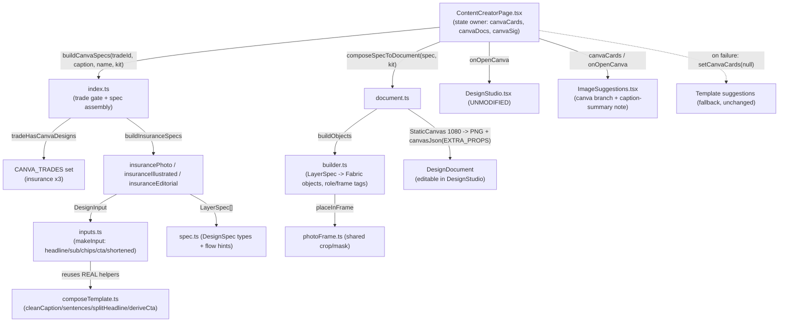

# Design Document — Canva-Style Automatic Design Integration

> **Documentation-first design.** This document describes the architecture **as it already
> exists in code** (verified by reading `apps/web/src/lib/canvaDesigns/*` and the integration
> points in `ContentCreatorPage.tsx` / `ImageSuggestions.tsx`). It is not a proposal to rebuild
> the engine. Its job is to (1) make the current design explicit, (2) tie each piece to a
> requirement, (3) call out the real blockers/incomplete integrations, and (4) define a phased
> validation and controlled-rollout plan with an explicit deployment approval gate.
>
> This spec is **separate from `create-tab-redesign`**. The Canva engine is self-contained under
> `apps/web/src/lib/canvaDesigns/` and plugs into the existing suggestion strip; it does not
> depend on, and must not entangle with, the Create tab launcher/workflow restructuring.

## Overview

When a signed-in user on an insurance trade composes a post, `ContentCreatorPage` calls the
Canva engine to build three genuinely different design specs (`photo`, `illustrated`,
`editorial`) from the user's caption + Brand Kit, renders full-resolution previews client-side,
and shows them in the existing suggestion strip in place of the template cards. Selecting one
opens it in the **unmodified** Design Studio as individually editable Fabric layers. Everything
is client-side: no network, no AI, no image credits. If anything fails, the page clears the
Canva cards and falls back to the existing template suggestions.

The engine is **trade-gated**: only `insurance-agent`, `health-insurance-agent`, and
`insurance-producer` receive Canva designs today. All other 56 trades keep their existing
template suggestions unchanged. Expansion happens later in controlled phases, reusing the same
engine.

## Architecture

### Layered structure (all under `apps/web/src/lib/canvaDesigns/`)



### Data and control flow

1. **Trade gate** (`index.ts`, Req 1, 2, 11): `tradeHasCanvaDesigns(tradeId)` returns true only
   for the three insurance trades. `buildCanvaSpecs` returns `null` for non-Canva trades or an
   empty caption, which the page reads as "use templates".
2. **Spec assembly** (`index.ts` → `inputs.ts` → style modules, Req 1, 3, 4): `buildInsuranceSpecs`
   calls `makeInput` three times with different display budgets, then the three style modules
   (`insurancePhoto`, `insuranceIllustrated`, `insuranceEditorial`) each return a `DesignSpec`
   (a plain list of `LayerSpec`s). `makeInput` derives headline/supporting text/chips/CTA using
   the app's **real** `composeTemplate.ts` helpers, so nothing is invented.
3. **Compose to preview + document** (`document.ts` → `builder.ts`, Req 5, 7): `composeSpecToDocument`
   loads fonts, builds one Fabric object per layer on an off-screen `StaticCanvas` (1080x1080),
   exports a PNG preview, and serializes the canvas JSON with `EXTRA_PROPS` so role/frame/mask
   tags round-trip into the Studio. It reports `imageShowsSummary`. Pure client-side.
4. **Render in strip** (`ImageSuggestions.tsx`, Req 2, 4, 9): when `canvaCards` is non-empty the
   strip renders the Canva cards (grid on wide, scroll on narrow) with "Use This Design" /
   "Customize", a `data-canva="1"` marker, and the `caption-summary-note` when any card shows a
   summary. The template path is untouched for other trades.
5. **Open in Studio** (`openCanvaCard` → `DesignStudio`, Req 5, 6, 10): looks up the cached
   `toDocument(name)` by card id and opens the editable document in the unmodified Studio.
6. **Fallback** (`ContentCreatorPage` effect, Req 2): the compose effect is wrapped in
   try/catch; on any failure it calls `setCanvaCards(null)` and clears caches so the strip shows
   templates. A `canvaSig` signature prevents recompute on trivial keystrokes.

### Why this is the right shape (and the smallest safe integration)

- The engine is isolated in its own folder with a single public entry (`index.ts`), so the
  blast radius on the rest of Create is one import plus one effect, one handler, and the two
  props passed to `ImageSuggestions`.
- The Design Studio, media upload, scheduling, posting, drafts, and tier gating are **reused
  unchanged** (Req 2, 5, 7, 10). The engine produces a standard `DesignDocument`, so everything
  downstream already knows how to handle it.
- Trade gating is a single `Set`, making phased rollout (Req 11) a one-line change per phase
  with no engine rework.

## Components and Interfaces

### Public API — `index.ts` (Req 1, 2, 3, 11)

```ts
function tradeHasCanvaDesigns(tradeId: string | undefined): boolean;
function buildInsuranceSpecs(caption: string, tradeName: string | undefined, kit: BrandKit): DesignSpec[];
function buildCanvaSpecs(tradeId: string | undefined, caption: string, tradeName: string | undefined, kit: BrandKit): DesignSpec[] | null;
const CANVA_TRADES = new Set(['insurance-agent', 'health-insurance-agent', 'insurance-producer']);
```
- `toLite(kit)` maps the full Brand Kit to `{ company, phone, accent }`, treating the default
  orange as "not chosen" (Req 3.5). Empty fields pass through empty so layers are omitted (Req 3.3).

### Composition — `document.ts` (Req 4, 5, 7)

```ts
interface ComposedDesign {
  id: string; spec: DesignSpec; previewUrl: string;
  toDocument: (name: string) => DesignDocument; // editable Studio doc
  imageShowsSummary: boolean;
}
async function composeSpecToDocument(spec: DesignSpec, kit: BrandKit): Promise<ComposedDesign>;
```
- Renders on an off-screen `StaticCanvas` and disposes it (no leak). Serializes with
  `EXTRA_PROPS` so `data.frame`, `data.role`, `data.fullCaption`, `data.fullText` survive
  save/reopen (Req 4.4, 5.4).

### Spec and builder — `spec.ts`, `builder.ts` (Req 5, 6)

- `DesignSpec` = `{ id, title, style, trade, width, height, background, layers, caption,
  needsPropertyPhoto?, imageShowsSummary? }`.
- `LayerSpec` kinds: `rect`, `ellipse`, `path`, `photo`, `text`. Flow hints (`below`/`maxTop`,
  `wrap`, `centerIn`, `zone`, `fit`) give measured spacing instead of hand-tuned coordinates
  (this is what fixed the illustrated CTA/footer spacing, Req 9 adjacency).
- `builder.ts` turns each layer into exactly one Fabric object tagged with the `data` role tags
  the Studio already understands (`isHeadline`, `isSubtext`, `isBrandSlot`, `isPhoneSlot`,
  `isCta`, `isPhoto`, `mask`, `frame`). Photos use `placeInFrame` from the shared
  `photoFrame.ts` so replacement preserves shape/mask/crop and re-fits to the focal point
  (Req 6.2, 6.3).
- The headline layer carries `data.fullCaption` (Req 4.1, 4.4). `fitTextbox` shrinks text with
  real font metrics and, only if still too long, cuts at a word boundary with an ellipsis while
  keeping `data.fullText` (Req 4.4, 4.5).

### Brand + copy helpers — `kit.ts`, `inputs.ts` (Req 3, 4)

- `brandBlock` emits name/phone layers **only** when present (Req 3.2, 3.3); never a placeholder.
- `makeInput` builds headline/sub/chips/CTA from the caption via `composeTemplate.ts`; `summarize`
  / `wrapExcerpt` produce an ellipsized summary and set `shortened` (Req 4.2, 4.3, 4.5). `chipsFromCaption`
  only emits noun-phrases literally present in the caption (Req 3.6).

### Integration — `ContentCreatorPage.tsx` (Req 2, 4, 10)

- State: `canvaCards: CanvaCard[] | null`, `canvaDocs: Map<id,{spec,toDocument}>`, `canvaSig`.
- Effect (gated on `suggestionSignature`): builds specs, composes in parallel, sets cards; on
  failure clears cards (fallback). `openCanvaCard` opens the cached document in the Studio.
- Strip renders when `imageSuggestions.length > 0 || (canvaCards && canvaCards.length > 0)`.

### Strip — `ImageSuggestions.tsx` (Req 2, 4, 9)

```ts
interface CanvaCard { id: string; name: string; style: 'photo'|'illustrated'|'editorial'; previewUrl: string; imageShowsSummary: boolean; }
// props: canvaCards?: CanvaCard[] | null; onOpenCanva?: (card: CanvaCard) => void;
```
- `useCanva` branch renders Canva cards; `caption-summary-note` shown when any card summarizes.

### Setup Guide — `SetupWizard.tsx` (Req 9)

- Starts collapsed on `/create` so it cannot overlap the composer or gallery.

### Component → requirement map

| Area | File(s) | Requirements |
| --- | --- | --- |
| Trade gate + spec assembly | `index.ts` | 1, 2, 3, 11 |
| Three distinct styles | `insurancePhoto/Illustrated/Editorial.ts` | 1 |
| Copy derivation (no invention) | `inputs.ts`, `kit.ts`, `composeTemplate.ts` | 3, 4 |
| Preview + editable document | `document.ts`, `builder.ts` | 4, 5, 7 |
| Photo frames / replacement | `builder.ts`, `photoFrame.ts` | 6 |
| Strip render + summary note | `ImageSuggestions.tsx` | 2, 4, 9 |
| Page wiring + fallback | `ContentCreatorPage.tsx` | 2, 4, 10 |
| Setup Guide overlap | `SetupWizard.tsx` | 9 |
| Assets + licenses | `assets/fonts`, `assets/photos`, `LICENSES.json` | 8 |

## Data Models

**No new persisted data models.** Canva designs produce a standard `DesignDocument` (the same
type the Studio saves today). View state is ephemeral.

```ts
// Produced by the engine, consumed by the existing Design Studio / draft / schedule flows:
interface DesignDocument { id; name; templateId; width; height; canvasJson; thumbnail; createdAt; updatedAt; }

// Ephemeral page/strip state (not persisted beyond existing keys):
interface CanvaCard { id; name; style: 'photo'|'illustrated'|'editorial'; previewUrl; imageShowsSummary; }
type DesignSpec = { id; title; style; trade; width; height; background; layers: LayerSpec[]; caption; needsPropertyPhoto?; imageShowsSummary? };
```

Existing persistence reused unchanged: drafts (`hawkeye_draft_*`), saved post history, cloud
design store, Brand Kit — all untouched by this feature.

## Correctness Properties

Most of this feature is deterministic rendering best covered by example/snapshot/integration
tests. Two input-varying guarantees are worth property tests, since they encode the user's hard
constraints.

### Property 1: No invented business identity

*For any* caption and *any* Brand Kit, every brand/identity string rendered into a design
(company, phone, logo, accent) is either absent or exactly equals the corresponding Brand Kit
value — never a placeholder or fabricated value. In particular, an empty Brand Kit yields no
business-name, phone, or logo layer, and the default primary color is never applied as a custom
accent.

**Validates: Requirements 3**

### Property 2: Full caption is always preserved

*For any* caption, the composed design carries the complete original caption verbatim in layer
data (`data.fullCaption` / `data.fullText`), and whenever a displayed string is a shortened
version it is flagged (`imageShowsSummary` / `excerpt`) so the UI shows the Caption_Summary_Notice.
No caption text is lost by composition, editing, or reopen.

**Validates: Requirements 4**

### Property 3: Trade gate is exact

*For any* trade id, `buildCanvaSpecs` returns designs only when the id is in the Canva_Trade set
and the caption is non-empty; otherwise it returns `null` (templates). This encodes insurance-only
scoping and the fallback contract.

**Validates: Requirements 1, 2, 11**

> Library: **fast-check** (already a devDependency), >= 100 iterations. Tag each test, e.g.
> `// Feature: canva-style-design-integration, Property 1: No invented business identity`.

## Error Handling

- **Compose/render failure (Req 2.1):** the page effect catches, clears Canva cards and caches,
  and shows the Template_Fallback. No error surfaced destructively; the user simply sees templates.
- **Open failure (Req 5):** `openCanvaCard` with a missing cache entry shows a toast and does
  nothing destructive.
- **Empty Brand Kit (Req 3.3):** layers omitted, not errored.
- **Empty caption (Req 1.4):** no designs produced; templates shown.
- **Tier limits (Req 7.4):** unchanged; Canva designs are always free and never touch the AI
  image quota.

## Testing Strategy

Weighted toward example/integration tests over the real engine + existing Studio, plus the three
property tests above.

### Unit / snapshot (web)
- `buildCanvaSpecs` returns three distinct styles for insurance; `null` for other trades / empty
  caption (Req 1, 2, 11).
- `ImageSuggestions` renders Canva cards with correct labels, the `data-canva="1"` marker, and
  the `caption-summary-note` only when a card summarizes (Req 2, 4).
- `brandBlock` omits empty name/phone (Req 3.3); default color not applied as accent (Req 3.5).

### Integration (mock-based)
- Compose → `toDocument` → open in the unmodified Studio; layers carry role/frame tags; save and
  reopen preserves crop/mask/role and full caption (Req 5, 4).
- Photo replacement preserves frame shape/mask and re-fits focal point (Req 6).
- Fallback: forcing a compose failure yields templates; a non-insurance trade never produces
  Canva cards (Req 2).

### Property-based
- Properties 1–3 on the pure portions (`buildCanvaSpecs`, `makeInput`/`brandBlock`,
  caption-preservation in `builder`), >= 100 iterations.

### End-to-end (authenticated, Req 10)
- Desktop and mobile: select a design, customize in Studio, save as draft, reopen with design
  intact, schedule and publish through existing flows, confirm 0 AI calls and no auto-posting.
- Scripts: `scripts/e2e-insurance-canva.mjs` (authenticated flow), `scripts/run-canva-checks.ps1`
  (render/studio/replace/original-validator), review HTML under `suggestions-validation/`.

### Asset compliance (Req 8)
- `assets/photos/LICENSES.json` documents every shipped photo's source and license; a check
  confirms no identifiable private-property/people images ship and all fonts carry licenses.

## Known Blockers, Regressions, and Incomplete Integrations

1. **Mobile E2E not green** — last run failed clicking "Write" (overlay-obscured; harness issue,
   not product). Robustness fix applied to `scripts/e2e-insurance-canva.mjs`, **not yet re-run**.
   *Blocker for Req 10.5.*
2. **Fallback not fully exercised E2E** — need a confirmed run for a non-insurance trade and a
   forced insurance compose failure. *Blocker for Req 2.1, 10.6.*
3. **Draft/schedule/publish not validated E2E with a Canva design attached.** *Blocker for Req 10.3, 10.4.*
4. **Full suite + `tsc --noEmit -p apps/web` not re-run** after the latest edits. *Verification gap.*
5. **Dev prototype tree `apps/web/src/dev/canva/` still present** (roofing/realEstate prototypes,
   harness, registry). Not on the shipping path; disposition (keep as dev-only vs. remove) is open.
6. **AWS Lambda concurrency support case unresolved** — production release blocked regardless of
   feature readiness. *Blocker for Req 12.4.*
7. **Remaining 56 trades undesigned** — intentional; deferred to Rollout_Phases (Req 11).

## Phased Validation and Rollout Plan

- **Phase V (Validate insurance):** re-run mobile E2E green; confirm fallback (non-insurance +
  forced failure); validate draft/schedule/publish E2E; re-run full suite + typecheck; produce a
  review page. Satisfies Req 10.
- **Deployment Approval Gate (Req 12):** all work local/uncommitted; no merge/push/deploy without
  explicit approval; gate requires Phase V complete and reviewed; while the AWS concurrency case
  is open, production release stays blocked. On approval, stage only this feature's files.
- **Phase 1..N (Rollout, Req 11):** after insurance approval, add trades in bounded batches
  (10–12 polished categories first, then the rest with sensible fallbacks), reusing the same
  engine and validation. Each batch is a small change to the Canva_Trade set plus that batch's
  style inputs; untouched trades keep templates.

## Out of Scope (explicit)

- `create-tab-redesign` workflow/launcher restructuring (separate spec).
- React Native mobile Create screen design generation (web only here).
- Any change to the Design Studio, media upload, scheduling, posting, drafts, or tier gating.
- Any production merge/push/deploy before the Deployment_Approval_Gate.
